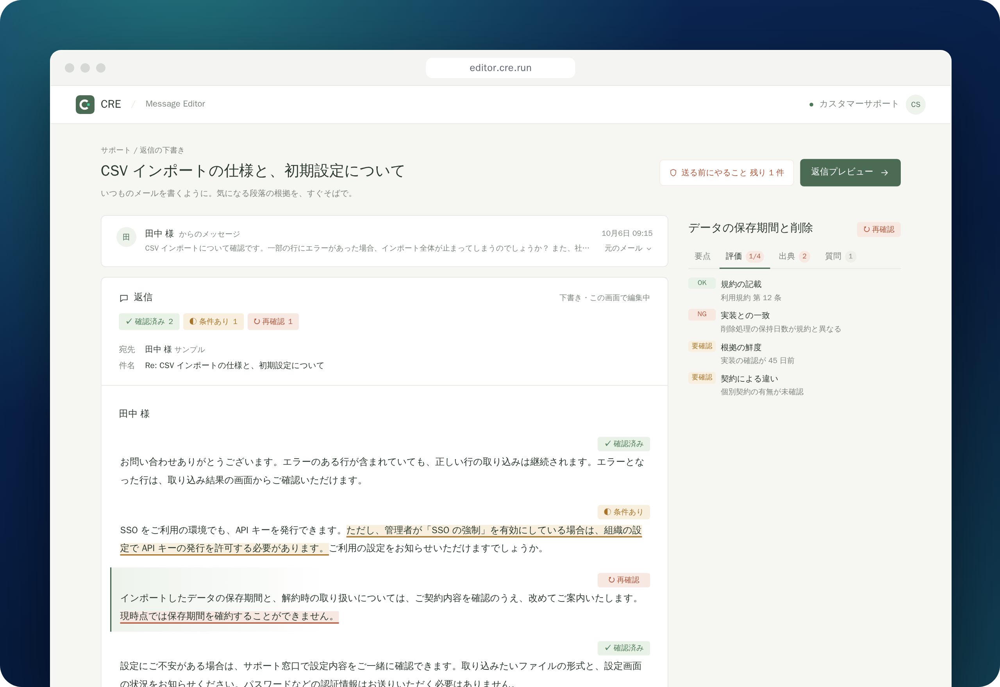

<div align="center">


# CRE

**確かめた部分に下線を。下線ごとの根拠を、すぐそばで。**

カスタマーサポートの返信を、下線ごとの根拠と確認状況を見ながら確かめられる<br />
**Message Editor** を開発しています。

[](https://editor.cre.run)
[](https://docs.cre.run)

[](https://github.com/cre-run/cre/actions/workflows/ci.yml)
[](https://github.com/cre-run/cre/actions/workflows/e2e.yml)

</div>

<br />

<a href="https://editor.cre.run"></a>

<p align="center"><sub>見本データ（架空の問い合わせ）で動くプロトタイプの画面です</sub></p>

## Message Editor

返信の本文のうち判定した部分に下線を引き、下線ごとに **何を根拠にしているか** と **その根拠をどこまで確認できているか** を本文の横に表示し、安心して送れるかどうかを判断しやすくするエディターです。根拠が足りない箇所は文章を作らず、人が書き起こす空欄にします。
いまはプロトタイプで、[editor.cre.run](https://editor.cre.run) で画面を試せます。

<table>
  <tr>
    <td width="50%" valign="top">
      <br />
      <strong>下線ごとの確認状況</strong><br />
      判定した部分に下線を引き、すぐ後ろに「確認済み・条件あり・再確認」を表示します。根拠が足りない箇所は「要記入」の空欄になります。どこを確かめればよいかがひと目で分かります。
    </td>
    <td width="50%" valign="top">
      <br />
      <strong>根拠をすぐそばで</strong><br />
      下線を選ぶと、右側にその下線の要点・評価・出典・質問をタブで表示します。出典の種類・立場・確認日まで確かめられます。
    </td>
  </tr>
  <tr>
    <td width="50%" valign="top">
      <br />
      <strong>送る前にやること</strong><br />
      確認済み以外の下線と空欄について、取るべきアクションと担当をまとめて表示します。あと何件で送れるかが分かります。
    </td>
    <td width="50%" valign="top">
      <br />
      <strong>データはブラウザの中だけ</strong><br />
      判定データは URL の <code>#</code> 以降に載せて渡すため、サーバーには送られません。詳しくは<a href="https://docs.cre.run/message-editor/data-handling">判定データの扱い</a>へ。
    </td>
  </tr>
</table>

使い方は [ガイド](https://docs.cre.run/message-editor) にまとめています。

## リポジトリの構成

[Vite+](https://viteplus.dev/) で管理しているモノレポです。アプリは Cloudflare Workers で配信しています。

| パス                                                                                       | 内容                                                                                                        | 公開先                                   |
| ------------------------------------------------------------------------------------------ | ----------------------------------------------------------------------------------------------------------- | ---------------------------------------- |
| [`apps/message-editor`](apps/message-editor)<br /><sub>`@cre/message-editor`</sub>         | Message Editor のモック（SPA。データは URL の `#d=` で渡す）。Worker は `cre-editor`                        | [editor.cre.run](https://editor.cre.run) |
| [`apps/docs`](apps/docs)<br /><sub>`@cre/docs`</sub>                                       | Blume で構築するドキュメントサイト。Worker は `cre-docs`                                                    | [docs.cre.run](https://docs.cre.run)     |
| [`apps/lp`](apps/lp)<br /><sub>`@cre/lp`</sub>                                             | トップページ（準備中）。Worker は `cre-lp`                                                                  | [cre.run](https://cre.run)               |
| [`apps/short-url`](apps/short-url)                                                         | （実装中・デプロイ準備中）Message Editor 専用の短縮 URL サービス。`cre-short` + D1 で、セルフホストして使う | 準備中                                   |
| [`apps/sample`](apps/sample)<br /><sub>`@cre/app-sample`</sub>                             | Vite アプリの見本                                                                                           | —                                        |
| [`packages/editor-payload`](packages/editor-payload)<br /><sub>`@cre/editor-payload`</sub> | Message Editor の判定データの型と、URL の `#d=` に載せる圧縮・展開・検証。Message Editor と短縮 URL で共有  | —                                        |
| [`packages/guide-promises`](packages/guide-promises)<br /><sub>`@cre/guide-promises`</sub> | 約束のガイドの「テスト」列のバッジと実際のテストを突き合わせる道具                                          | —                                        |
| [`packages/asset`](packages/asset)                                                         | ロゴ・ファビコンなどのブランドアセット                                                                      | —                                        |
| [`packages/sample`](packages/sample)<br /><sub>`@cre/sample`</sub>                         | `vp pack` でビルドするライブラリの見本                                                                      | —                                        |

短縮 URL の設計は [`apps/short-url/README.md`](apps/short-url/README.md) にあります。

## 開発


ユーザー向けのガイドを先に書き、E2E と画像の比較（VRT）で「ガイドどおりに動くこと」を確かめ続ける進め方をしています。
ガイドの画像と、この README の先頭の画像は、E2E が CI で撮っています。

[Vite+ CLI (`vp`)](https://viteplus.dev/guide/) をインストールした上で:

```bash
vp install         # 依存関係のインストール
vp check           # format + lint + typecheck
vp run -r test     # 全パッケージのテスト
vp run -r build    # 全パッケージのビルド
vp run ready       # 上記をまとめて実行
vp run dev         # apps/sample の開発サーバー
```

## AI エージェント

Claude Code・Codex 向けの内部ガイドは [AGENTS.md](AGENTS.md) にあります。`CLAUDE.md` は `@AGENTS.md` を読み込むだけなので、内容は `AGENTS.md` に書いてください。
チーム共通の Claude Code の設定は `.claude/settings.json`（応答は日本語）です。個人の設定は `.claude/settings.local.json` に書いてください。

---

<div align="center">

CRE のソースコードは GitHub で公開しています。<br />
Star や X（[@ToyB0x\_](https://x.com/ToyB0x_)）のフォローをいただけると、開発の励みになります。

[](https://github.com/cre-run/cre)
[](https://x.com/ToyB0x_)

</div>
