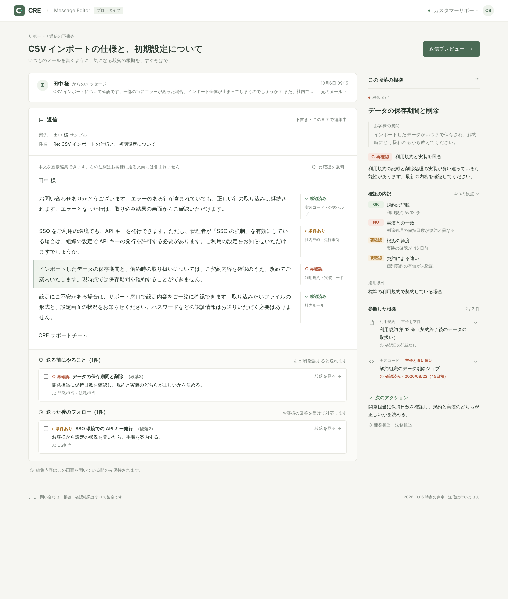

<Badge variant="warning">planned</Badge>
この機能はまだリリースされていません。画面は開発中のモックです。

カスタマーサポートで技術的な内容に返信するとき、「この説明で本当に合っているか」が不安になることがあります。
Message Editor は、返信の段落ごとに **何を根拠にしているか** と **その根拠をどこまで確認できているか** を本文の横に表示し、安心して送れるかどうかを判断しやすくします。

<Frame caption="段落を選ぶと、右側に「この段落の根拠」が表示されます（モック）">
  
</Frame>

## 画面の見方

1. **お客様からのメッセージ** — 問い合わせの冒頭を表示します。「元のメール」で全文を開けます
2. **返信** — いつものメールと同じように本文を直接編集できます。段落ごとに、右側へ確認状況と根拠の種類が表示されます
3. **この段落の根拠** — 選んだ段落について、お客様の質問、確認の内訳、適用条件、参照した根拠、次のアクションを表示します
4. **送る前にやること** — 返信の下部に、確認済み以外の段落について取るべきアクションと担当がまとめて表示されます。済んだものにチェックを付けると、あと何件で送れるかが分かります。「段落を見る」でその段落の根拠へ移動できます

右側の注釈は、お客様に送る文面には含まれません。「返信プレビュー」で、送る文面だけを確認できます。

### 送る前にやること・送った後のフォロー

| 区分               | 対象の段落       | 例                                             |
| ------------------ | ---------------- | ---------------------------------------------- |
| 送る前にやること   | 再確認・根拠なし | 規約と実装の食い違いを開発担当に確認する       |
| 送った後のフォロー | 条件あり         | お客様から設定の状況を聞いたら、手順を案内する |

確認すべき段落がなければ「追加で確認することはありません。このまま送れます。」と表示されます。

### 段落の確認状況

| 状態     | 意味                                                                         |
| -------- | ---------------------------------------------------------------------------- |
| 確認済み | 根拠が確認できています                                                       |
| 条件あり | 条件つきで成り立ちます。お客様の設定や契約などの確認が必要です               |
| 再確認   | 根拠が古い、または根拠どうしが食い違っています。送る前に確認し直してください |
| 根拠なし | 根拠が見つかっていません                                                     |

<Frame caption="再確認が必要な段落では、確認の内訳と食い違っている根拠、送る前にやることが表示されます（モック）">
  
</Frame>

## 根拠の種類

根拠ごとに、種類と「段落の主張に対する立場（支持・条件つきで支持・食い違い）」、確認した日時を表示します。どの種類を使うかは、今後の検討で変わる可能性があります。

- **利用規約** — 規約の条文
- **社内ルール** — サポートの運用ルール
- **先行事例** — 以前の問い合わせへの対応
- **判例** — 法的な判断の参考
- **実装コード** — 実際のコードで仕様を確認したもの。確認した日がどれくらい前か（鮮度）も表示します
- **社内FAQ** — 社内でまとめたドキュメント
- **公式ヘルプ** — 公開しているヘルプの引用

## 判定データの渡し方

初期版はバックエンドを持たず、判定結果を URL に載せて渡します（プロトタイプは `editor.cre.run` で公開予定です）。
問い合わせ・返信の段落・確認の内訳・根拠をまとめた JSON を pako で圧縮し、URL の `#d=` 以降に付けて開くと、その内容が表示されます。

```text
https://editor.cre.run/#d=<圧縮した判定データ>
```
