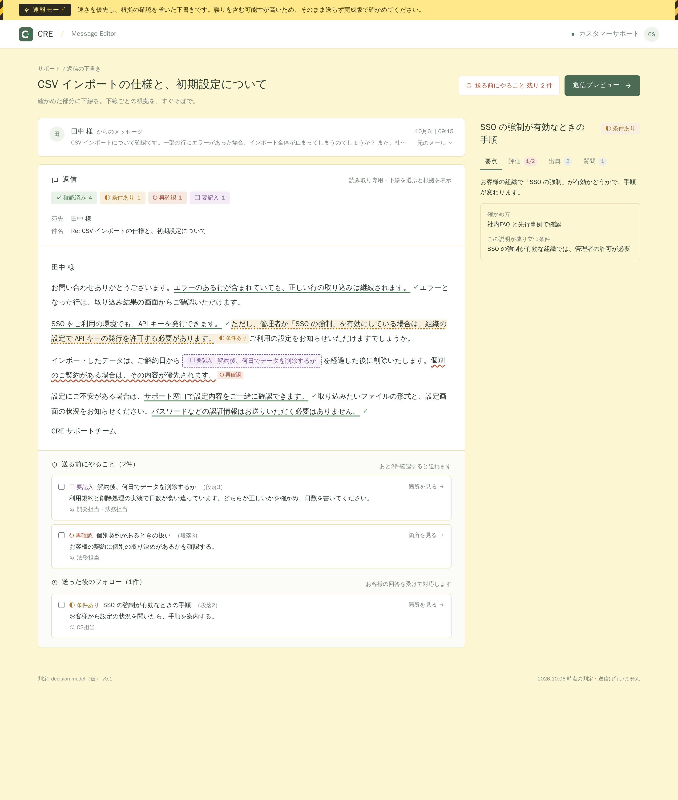

<Badge variant="accent">preview</Badge>
この機能はまだリリースされていません。画面と URL
での受け渡しは、プロトタイプ（[editor.cre.run](https://editor.cre.run)）で試せます。
実際の問い合わせから判定データを作る仕組みは開発中で、プロトタイプでは見本データか、手で用意した判定データだけを表示します。

カスタマーサポートで技術的な内容に返信するとき、「この説明で本当に合っているか」が不安になることがあります。
Message Editor は、返信の本文のうち **判定した部分に下線** を引き、**下線ごとに** 何を根拠にしているかと、その根拠をどこまで確認できているかを表示します。
1 つの段落の中でも「ここは確かめてある」「ここは社内で確認が必要」「ここは人が書く」を分けて示すので、確かめる場所をピンポイントで見つけられます。

画面は 2 つの列でできています。左の列で問い合わせと返信を読み、右の列で選んだ下線の根拠を確かめます。

## 画面の見方

返信の本文は **読み取り専用** です（この画面では編集できません）。本文の中で、判定した部分には次の印が付きます。

| 印                             | 状態     | 意味                                                                   |
| ------------------------------ | -------- | ---------------------------------------------------------------------- |
| 緑の下線と ✓                   | 確認済み | 十分な根拠があります                                                   |
| 黄色の点線の下線と「条件あり」 | 条件あり | 条件つきで成り立ちます。お客様の設定や契約などの確認が必要です         |
| 赤の波線の下線と「再確認」     | 再確認   | 根拠が古い、または根拠どうしが食い違っています。社内で確かめてください |
| 点線の枠と「要記入」           | 要記入   | 根拠が足りないため、文章を作っていません。人が書き起こします           |

- 印のない文章（あいさつなど）は、判定の対象外です
- 確認状況のラベルは、段落ではなく **下線のすぐ後ろ** に付きます
- 返信の上に、状態ごとの数（例: 確認済み 3・条件あり 1・再確認 1・要記入 1）を表示します。押すと、その状態の箇所へ順に移動します

<Frame caption="下線を選ぶと、右側にその下線の根拠が表示されます（モック）">
  
</Frame>

## 下線を選んで根拠を確かめる

下線をクリックする（または Tab キーで移動して Enter を押す）と、その下線だけが強調され、右側にその下線の根拠が表示されます。
右側の上に下線の見出しと確認状況を表示し、その下のタブで次の内容を切り替えて確かめられます。

- **要点** — 判定のひとこと、確かめ方、この説明が成り立つ条件
- **評価** — 確認した観点ごとの評価
- **出典** — この下線の根拠になった出典の種類・立場・確認日
- **質問** — この下線を含む段落が答えている、お客様の質問

<Frame caption="再確認の下線で「評価」タブを開いたところ。観点ごとの評価と、送る前にやることが表示されます（モック）">
  
</Frame>

## 空欄（要記入）を書き起こす

根拠が足りない箇所は、判定モデルが推測で文章を作らず、点線の枠の **空欄** にしています。枠には、決める必要があることが書かれています。

空欄をクリックすると、右側に次の内容が表示されます。

- **案内** — 何を確かめて、どう書けばよいか
- **選択肢** — 根拠のある候補と、それぞれの出典（例: 「30 日（利用規約）」「60 日（削除処理の実装）」）
- **担当** — 判断する担当

この画面では本文を編集できないので、確かめた内容は、返信をメールに貼り付けてから書き起こしてください。

## 送る前にやること

返信の下部に、確認済み以外の下線と空欄について、取るべきアクションと担当をまとめて表示します。

| 区分               | 対象                                       |
| ------------------ | ------------------------------------------ |
| 送る前にやること   | 要記入の空欄・再確認の下線                 |
| 送った後のフォロー | 条件ありの下線（お客様の回答を受けて対応） |

済んだものにチェックを付けると、あと何件で送れるかが分かります。「箇所を見る」で、その下線や空欄を選んだ状態にできます。

## 返信プレビュー

「返信プレビュー」で、お客様に送る文面だけを確認できます（下線と確認状況は含まれません）。
空欄は「［要記入：…］」として残るので、コピーしてメールに貼り付けたあと、書き起こしてから送ってください。
空欄が残っているときは、プレビューの上に件数が表示されます。

## 速報モード

判定データに `"mode": "flash"` を入れると、返信を「速報」として表示します（省略したときと `"standard"` のときは完成版）。

速報は、根拠の確認を省いて速く作った下書きです。完成版より誤りを含む可能性が高く、確認状況や根拠もあてになりません。

- 画面全体の背景が薄い黄色になります
- 画面の上に「速報モード」の帯が出ます（スクロールしても消えません）

速報の返信はそのまま送らず、完成版で確かめてから送ってください。

<Frame caption="速報モードの画面（モック）">
  
</Frame>

## 根拠の種類

根拠ごとに、種類と「下線の主張に対する立場（支持・条件つきで支持・食い違い）」、確認した日時を表示します。どの種類を使うかは、今後の検討で変わる可能性があります。

- **利用規約** — 規約の条文
- **社内ルール** — サポートの運用ルール
- **先行事例** — 以前の問い合わせへの対応
- **判例** — 法的な判断の参考
- **実装コード** — 実際のコードで仕様を確認したもの。確認した日がどれくらい前か（鮮度）も表示します
- **社内FAQ** — 社内でまとめたドキュメント
- **公式ヘルプ** — 公開しているヘルプの引用

## 判定データの渡し方

初期版はバックエンドを持たず、判定結果を URL に載せて渡します（プロトタイプは `editor.cre.run` で公開しています）。
問い合わせ・返信の本文（文章・下線・空欄）・下線ごとの確認の内訳と根拠をまとめた JSON を pako で圧縮し、URL の `#d=` 以降に付けて開くと、その内容が表示されます。

```text
https://editor.cre.run/#d=<圧縮した判定データ>
```

### 例: デモと同じ内容を URL で渡す

上の画面（見本データ）と同じ内容を、実際に pako で圧縮して `#d=` に載せた URL です。開くと、見本と同じ問い合わせ・返信・根拠が表示されます。
見本データの問い合わせ・根拠・確認結果はすべて架空です。

<a href="https://editor.cre.run/#d=eJztWVtvGkkW_iu9_TSjxQl2nGjDPEXZXWmfdncS7T6M_ECg4zDBQLhkEkWWqGpwuHlwML4wscc3bIgvja3Yie1g8mOK7oYn_4XVqb5Q3XTbGUX7FilCOHSdOrfvnO-cfsU_F-KJUDTC-8Y8_KQQEeL-pBC8l-R9_Jh37M7IqHfEe-fhqNfnhX9_9t71eb28h5-KBoUw73vFR_xTAu_jg0IgBGJG6A-X7Vz3k3TZzvOegXzee2OUn_bwocizVCj-Eg4_jkeneB-vVg-7pwec0ljmPXwi9ehnIQD333_wH47gOhHfE3GViG0i5giSup8WlMYyQU2SRnJuVVlZ6zUPZOk3gvYIqhOUIWiH9_BxISCEng9b4r3rG73NWhLzx_2TcX_sSYL3_fSKDwV5H_9slPfwSeGFqxaDq9TN897uLEENgmokjbun6b7YJEjqbZTgMdwk4js4hUoEYYK2CFqT14_luRxJI5tYOdvsXswTVFIONgnq0Id3CFqi32cIkugtSwS_pn8WL9tr_LTHUHlsoDI9sEbSSK135JksPdbiHjz4JwdfxQOCD_WrQfgONaSj6U_QPEGSWjmUN0V4GGPu3r_-wRF8ADriilo7p5bRc2kk1xfBXPyR4DMizhBxnaAiwfl-ekuZO6cXz-qy7freYvS1u3cJ1Bdf0ys_U9dlqMM7BDW6n1flg2WCFggukTTqNbbU44xSwzQo7wiaUfJHBJfhV1yk2mBloUZQjlpaJmgdzqIMSWNGm_GBNrak6p7OylJejx9IpGFIIyVf7LZXjSBlQGMQ_Ybgoro7L5e3jCMlgg7VtW2CC_SZjJkr_PTENCRqLEzBkIy6Q-FHwcd9FRyiMSESikzabwiEowntv-__-DeO4JOBaBHRL-suEImPUpAlYtFIMPEwyvt-AtRM0IeT2nNmNhbkhTJBGUh6XCboLXVLgfqnSVO5StAim4U0MP5EQognaenQ7_SPsjljIkvSIkPzsiTP7YEY8LoWlh2CMYTrYIvmVYY-JsnlRYILvU6boM8EtdQPNfXDb3pSmVp4-ETSn0wleB9UsdDjkBAEBaKxUIDVQLvYSI8mTXnLBTSUU1N-KHq8LK31trIENeXsvtwuE3GZiHtEXIKasbuvLP9KUKl7mu69Ph5Gp9zq9I42iDhHkXFKxAYFsaQXIYxlqdQ9nxk-CBVbSD6Jghe7p2llf0MRs_L6EUEN7SzkwhMh8FSLXNj_CKr7QFdXzXBRS4NUGIISfcp7-Eg0CR2BeqVK_bGn1Fd6zTacgpJxpCwsaRinz2igqfRrdbm-SCNvXu9krtt9arkD4qwPX7Zzz8c59f2ny3Z-YCt7h7J-phTXCZL6kiSf77hJH-WUpW05P0vQnoOQXjMN-Z17TdO6RtCvhv936aerk7qdolxfpE7aJbiorG50P30gqNXbKVL0Fpn60gHk4Hl-esLDC89DQSESEDScvYyBrEA0KGgpS3_gE6lYLApY9PDJUDKsx0SeXe5eQIIOACSWaU3JE3EXvuBD3sMLLwJCPAbqhh5z3_1JU_5G9On33CvusT8UFoI3YqnEk--0H77_gQtEI8lQJCX8wE2DEtFUnCohvPBPxcLCzdAU6CLEbyQTl-1cb6eorOxr_ICmnb1P37YzDvC2bucTIRy7xk5bmeyeHth6sVo7V6treqOhkLXY7FJcWtDloBOKFK96ByJoleBS99M2jaTW-FsM_Dv2mmL4xlYAuJsc0_PsBeQL3TQxTT01VCNpglH2oVuSRuwF6smc8vsKVJLqp_7qptbECaoa7IZpb4MaPWG2z_jYcDMYszYDh2rOMBbKTXCFoKqce6dWmzYOQtLIkYUw9OLacg1XDGQiieE1mjhLldYV6l58ZhC440qHqCJQ_efB1bhicq-_3_s3Zxaeq-uywwHnqux4qWtZNKS61o3H_mcsnALRSDAEgfKHGUSBP7TQUKrFes-CHI1kSnL7o5z7AFR2JS8XzgjaNUmvepJRz6oAFJ2nNFiXIkm3Dld6zSO53DJ8ZiVuDIpMA9m6cpPr7c72mm0n4HjvjoyNuwDHIUtZnqqDANqYKm2oczO9dBZaf7pktTs9S3DFMH2P7Za6GygA_7AnaiDgc7a3gwy-UXDMflsIGQA4hsbkLEq-2F-fseAAyJu0SRmmZOjbcLJ3IK-o0XD6RSfK_fUZoGb1PCXmhWvTvylnc72NUve82O0ULWgwLEtcZdBAUc3Pg1BJhitLmh-dAcYarcWGRdcv_nhkgC83JVgvtJSV3a-gHmPD3OMblK-A8oAqxGALEBQiyWv4AptuNnpi9YfhDBYLllLAWLpGB36gv9Z2tWZ2CTOtB5TAOihpki0aQegjwovkvYBWpthkhaZthEJSCx-U9wicj37XGzjOD-CIK8pGji4HoKpogYj-EhHiAAX-_gOlmJUv5nkrn2Das34P9OwCnW7zdLAbIgrWlYWdN9wa5g23nIfIa1YELUrEqvo2YGlbcwbNhUl_zKzmkzBBPksJCd152vNyB3hc92KBHmwMxOKKnC_0a3XdSZTHT6ZCQT2TNGf0dsrqcQaKFn1Wfr2jzsG2xhieGsrStrJwSFCpvwXzfx9Sf2to7_KOoA3qxZI5qlIjIEvoFwTB00ThivL2VKckQ3CKxvQCyVS0W16oIZftHKuynuAOdSQpxKcS12GGkcSp-_sc1KnVDbhj-416nFFPcPd8BlyLJBuvhQ0NytjxJV_Mq_WOzk0ZEWY0Oc0KcMlJqQ8zFiSBFrwBChyCt-RMv1kDoJxw8tkxN84pKzk1n9PT1HDgHdOBTkF296R9KIMxKe4PhgLWecVQWtdYH18XXWtRXEgKEQjzX_0vEz7ujpe7eZPTHgWl0nWnGSyWik8KIz9HH33BEOb9y8jY2ENaUC0kaYKtEv3Folo71yuFh1feL8jFmmPhGA4Z2jOio5WMpWuXP-yKLl2Uc9t0OKtqqWIuYFiCBZMZkuSZrCydQcvP7MrZ3BVLnrhA_cBwJu0i2xUMX4I8tm53LAckZSWvZja07ZymDZ1F9eFOOToHWLMQx3lmdaVP_JqWFuqjNGvKOUyb1hLUMC62E06X9Y7-9B7BOYKLtDBl3KmOi20lht248JJv9SR3ZeOWzEiYmW3JkEHmFU3a4Ny47Rhkeu34cK8dd-y1zAK5att-s-hyw-ltdkk7WCgbS_GGJl5HJZ35u6dp9WPFpLd_bK63Lr0l9koLMg3CcsJuz_uoCHQG9i9t-ERNt9Xr8KjCnLpyXFfKc93OWxaTViVcl4P2a9Klq2xIu8MvFEkK8Yg_PBJPha9dEbpfYUGXtiiSs0fKSl5_36Tvx1p0j9imq8SPtI-JVErDpIy2BNb4vbGQbsnlJYLe0PzP6wtUpzGB-2_oacg6KLBamyo7Ls5Gr16cWd8O0Jc24gLBG5SF7gE6LzZhdUfrumaWsTgb8G4rMR5-8eQAnTsMdMQ39J1ai5qjOeIdfUdgcRZBhT68SCww1Lts7AhazI5g0EiuApNFOq44hMJYNjHAuu6MnqD_D2zZ7laOMC2XX7R7H_KwQ-bpWfQNWF8FrAn4-B_mVVtU">
  見本データを URL で渡して開く
</a>

<details>
<summary>URL の全文</summary>

```text
https://editor.cre.run/#d=eJztWVtvGkkW_iu9_TSjxQl2nGjDPEXZXWmfdncS7T6M_ECg4zDBQLhkEkWWqGpwuHlwML4wscc3bIgvja3Yie1g8mOK7oYn_4XVqb5Q3XTbGUX7FilCOHSdOrfvnO-cfsU_F-KJUDTC-8Y8_KQQEeL-pBC8l-R9_Jh37M7IqHfEe-fhqNfnhX9_9t71eb28h5-KBoUw73vFR_xTAu_jg0IgBGJG6A-X7Vz3k3TZzvOegXzee2OUn_bwocizVCj-Eg4_jkeneB-vVg-7pwec0ljmPXwi9ehnIQD333_wH47gOhHfE3GViG0i5giSup8WlMYyQU2SRnJuVVlZ6zUPZOk3gvYIqhOUIWiH9_BxISCEng9b4r3rG73NWhLzx_2TcX_sSYL3_fSKDwV5H_9slPfwSeGFqxaDq9TN897uLEENgmokjbun6b7YJEjqbZTgMdwk4js4hUoEYYK2CFqT14_luRxJI5tYOdvsXswTVFIONgnq0Id3CFqi32cIkugtSwS_pn8WL9tr_LTHUHlsoDI9sEbSSK135JksPdbiHjz4JwdfxQOCD_WrQfgONaSj6U_QPEGSWjmUN0V4GGPu3r_-wRF8ADriilo7p5bRc2kk1xfBXPyR4DMizhBxnaAiwfl-ekuZO6cXz-qy7freYvS1u3cJ1Bdf0ys_U9dlqMM7BDW6n1flg2WCFggukTTqNbbU44xSwzQo7wiaUfJHBJfhV1yk2mBloUZQjlpaJmgdzqIMSWNGm_GBNrak6p7OylJejx9IpGFIIyVf7LZXjSBlQGMQ_Ybgoro7L5e3jCMlgg7VtW2CC_SZjJkr_PTENCRqLEzBkIy6Q-FHwcd9FRyiMSESikzabwiEowntv-__-DeO4JOBaBHRL-suEImPUpAlYtFIMPEwyvt-AtRM0IeT2nNmNhbkhTJBGUh6XCboLXVLgfqnSVO5StAim4U0MP5EQognaenQ7_SPsjljIkvSIkPzsiTP7YEY8LoWlh2CMYTrYIvmVYY-JsnlRYILvU6boM8EtdQPNfXDb3pSmVp4-ETSn0wleB9UsdDjkBAEBaKxUIDVQLvYSI8mTXnLBTSUU1N-KHq8LK31trIENeXsvtwuE3GZiHtEXIKasbuvLP9KUKl7mu69Ph5Gp9zq9I42iDhHkXFKxAYFsaQXIYxlqdQ9nxk-CBVbSD6Jghe7p2llf0MRs_L6EUEN7SzkwhMh8FSLXNj_CKr7QFdXzXBRS4NUGIISfcp7-Eg0CR2BeqVK_bGn1Fd6zTacgpJxpCwsaRinz2igqfRrdbm-SCNvXu9krtt9arkD4qwPX7Zzz8c59f2ny3Z-YCt7h7J-phTXCZL6kiSf77hJH-WUpW05P0vQnoOQXjMN-Z17TdO6RtCvhv936aerk7qdolxfpE7aJbiorG50P30gqNXbKVL0Fpn60gHk4Hl-esLDC89DQSESEDScvYyBrEA0KGgpS3_gE6lYLApY9PDJUDKsx0SeXe5eQIIOACSWaU3JE3EXvuBD3sMLLwJCPAbqhh5z3_1JU_5G9On33CvusT8UFoI3YqnEk--0H77_gQtEI8lQJCX8wE2DEtFUnCohvPBPxcLCzdAU6CLEbyQTl-1cb6eorOxr_ICmnb1P37YzDvC2bucTIRy7xk5bmeyeHth6sVo7V6treqOhkLXY7FJcWtDloBOKFK96ByJoleBS99M2jaTW-FsM_Dv2mmL4xlYAuJsc0_PsBeQL3TQxTT01VCNpglH2oVuSRuwF6smc8vsKVJLqp_7qptbECaoa7IZpb4MaPWG2z_jYcDMYszYDh2rOMBbKTXCFoKqce6dWmzYOQtLIkYUw9OLacg1XDGQiieE1mjhLldYV6l58ZhC440qHqCJQ_efB1bhicq-_3_s3Zxaeq-uywwHnqux4qWtZNKS61o3H_mcsnALRSDAEgfKHGUSBP7TQUKrFes-CHI1kSnL7o5z7AFR2JS8XzgjaNUmvepJRz6oAFJ2nNFiXIkm3Dld6zSO53DJ8ZiVuDIpMA9m6cpPr7c72mm0n4HjvjoyNuwDHIUtZnqqDANqYKm2oczO9dBZaf7pktTs9S3DFMH2P7Za6GygA_7AnaiDgc7a3gwy-UXDMflsIGQA4hsbkLEq-2F-fseAAyJu0SRmmZOjbcLJ3IK-o0XD6RSfK_fUZoGb1PCXmhWvTvylnc72NUve82O0ULWgwLEtcZdBAUc3Pg1BJhitLmh-dAcYarcWGRdcv_nhkgC83JVgvtJSV3a-gHmPD3OMblK-A8oAqxGALEBQiyWv4AptuNnpi9YfhDBYLllLAWLpGB36gv9Z2tWZ2CTOtB5TAOihpki0aQegjwovkvYBWpthkhaZthEJSCx-U9wicj37XGzjOD-CIK8pGji4HoKpogYj-EhHiAAX-_gOlmJUv5nkrn2Das34P9OwCnW7zdLAbIgrWlYWdN9wa5g23nIfIa1YELUrEqvo2YGlbcwbNhUl_zKzmkzBBPksJCd152vNyB3hc92KBHmwMxOKKnC_0a3XdSZTHT6ZCQT2TNGf0dsrqcQaKFn1Wfr2jzsG2xhieGsrStrJwSFCpvwXzfx9Sf2to7_KOoA3qxZI5qlIjIEvoFwTB00ThivL2VKckQ3CKxvQCyVS0W16oIZftHKuynuAOdSQpxKcS12GGkcSp-_sc1KnVDbhj-416nFFPcPd8BlyLJBuvhQ0NytjxJV_Mq_WOzk0ZEWY0Oc0KcMlJqQ8zFiSBFrwBChyCt-RMv1kDoJxw8tkxN84pKzk1n9PT1HDgHdOBTkF296R9KIMxKe4PhgLWecVQWtdYH18XXWtRXEgKEQjzX_0vEz7ujpe7eZPTHgWl0nWnGSyWik8KIz9HH33BEOb9y8jY2ENaUC0kaYKtEv3Folo71yuFh1feL8jFmmPhGA4Z2jOio5WMpWuXP-yKLl2Uc9t0OKtqqWIuYFiCBZMZkuSZrCydQcvP7MrZ3BVLnrhA_cBwJu0i2xUMX4I8tm53LAckZSWvZja07ZymDZ1F9eFOOToHWLMQx3lmdaVP_JqWFuqjNGvKOUyb1hLUMC62E06X9Y7-9B7BOYKLtDBl3KmOi20lht248JJv9SR3ZeOWzEiYmW3JkEHmFU3a4Ny47Rhkeu34cK8dd-y1zAK5att-s-hyw-ltdkk7WCgbS_GGJl5HJZ35u6dp9WPFpLd_bK63Lr0l9koLMg3CcsJuz_uoCHQG9i9t-ERNt9Xr8KjCnLpyXFfKc93OWxaTViVcl4P2a9Klq2xIu8MvFEkK8Yg_PBJPha9dEbpfYUGXtiiSs0fKSl5_36Tvx1p0j9imq8SPtI-JVErDpIy2BNb4vbGQbsnlJYLe0PzP6wtUpzGB-2_oacg6KLBamyo7Ls5Gr16cWd8O0Jc24gLBG5SF7gE6LzZhdUfrumaWsTgb8G4rMR5-8eQAnTsMdMQ39J1ai5qjOeIdfUdgcRZBhT68SCww1Lts7AhazI5g0EiuApNFOq44hMJYNjHAuu6MnqD_D2zZ7laOMC2XX7R7H_KwQ-bpWfQNWF8FrAn4-B_mVVtU
```

</details>

URL の長さは内容に比例し、見本データで約 3,700 文字です。チャットやチケットによっては貼れる長さに上限があります。

JSON から URL を作るには、`apps/message-editor` のスクリプトを使います。

```bash
cd apps/message-editor
node scripts/encode.ts payload.json --base https://editor.cre.run/
```

### 判定データの扱いについて

URL で渡す形式は手軽な一方、URL を見れば内容が分かります。次の点に注意してください。

- `#d=` 以降には、問い合わせ本文・宛名・返信文・根拠の引用が、**圧縮されただけで暗号化はされずに** 入っています。URL を知っている人は誰でも内容を読めます。URL を共有することは、判定データそのものを共有することと同じです
- `#` 以降はサーバー（Cloudflare）には送られず、editor.cre.run はデータを受け取りません。保存・送信・外部サービスへの連携も行いません。データはブラウザの中だけで復号・表示されます
- ただし、開いた URL はブラウザの履歴やブックマーク、リンクを貼ったチャットやチケットには残ります。実際のお客様の問い合わせを載せた URL は、社内の権限管理された場所にだけ貼ってください
- プロトタイプでは、URL から渡したデータをそのまま「判定結果」として表示します。誰が作った URL かは検証できないので、出所の分からない URL の内容を根拠にしないでください
- 送る前にやることに付けたチェックは、画面を閉じると消えます。ただし、返信プレビューでクリップボードにコピーした文面は、画面を閉じても残ります。画面からメールは送信されません

形式が合わないデータ（必須の項目がない、根拠のリンクが `http(s)` 以外、圧縮データが 10 万文字を超える、展開後が 1 MB を超える、など）は表示せず、見本データとエラーを表示します。
段落ごとに判定する以前の形式（`version` が `1`）の URL を開くと、エラーではなく、その形式を廃止したことと、新しい形式への切り替え方を案内します。
どこにデータが届き、どこに残るかの一覧は、[Message Editor のデータの取り扱い](/message-editor/data-handling)にまとめています。
