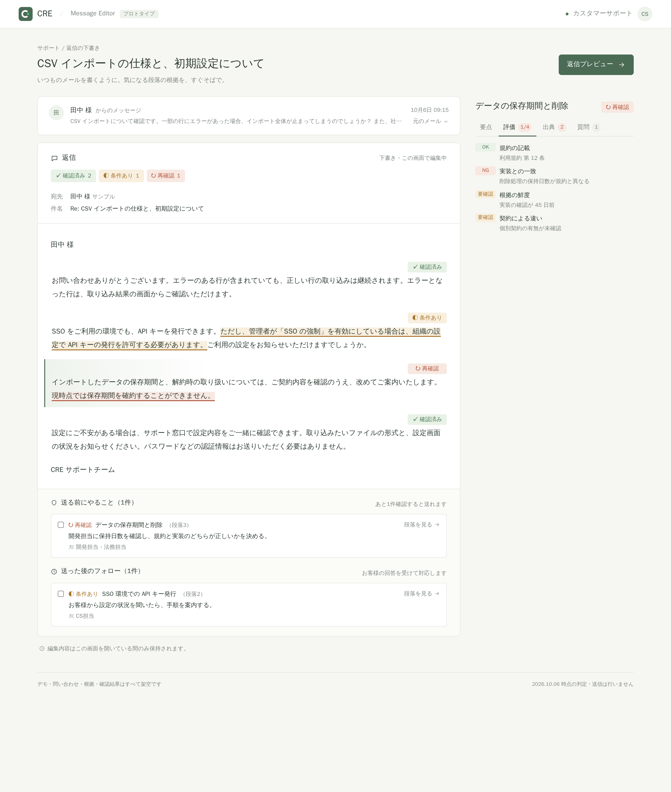

<Badge variant="accent">preview</Badge>
この機能はまだリリースされていません。画面と URL
での受け渡しは、プロトタイプ（[editor.cre.run](https://editor.cre.run)）で試せます。
実際の問い合わせから判定データを作る仕組みは開発中で、プロトタイプでは見本データか、手で用意した判定データだけを表示します。

カスタマーサポートで技術的な内容に返信するとき、「この説明で本当に合っているか」が不安になることがあります。
Message Editor は、返信の段落ごとに **何を根拠にしているか** と **その根拠をどこまで確認できているか** を本文の横に表示し、安心して送れるかどうかを判断しやすくします。

<Frame caption="段落を選ぶと、右側にその段落の根拠が表示されます（モック）">
  
</Frame>

画面は 2 つの列でできています。左の列で返信を書き、右の列で選んだ段落の根拠を確かめます。

## 画面の見方

1. **お客様からのメッセージ** — 問い合わせの冒頭を表示します。「元のメール」で全文を開けます
2. **返信** — いつものメールと同じように本文を直接編集できます。各段落の下に確認状況（確認済み・条件あり・再確認・根拠なし）が表示され、どの段落を確かめればよいかがひと目で分かります。段落をクリックすると、右側にその段落の根拠が表示されます
3. **選んだ段落の根拠** — 右側の上に、選んだ段落の見出しと確認状況を表示します。その下のタブで、次の内容を切り替えて確かめられます。最初は「要点」が開きます
   - **要点** — 判定のひとこと、適用条件、次のアクション
   - **内訳** — 確認した観点ごとの結果。NG や要確認があると件数が赤くなります
   - **根拠** — 参照した根拠の種類・立場・確認日。開くと引用とリンクを表示します
   - **質問** — この段落が答えている、お客様の質問
4. **送る前にやること** — 返信の下部に、確認済み以外の段落について取るべきアクションと担当がまとめて表示されます。済んだものにチェックを付けると、あと何件で送れるかが分かります。「段落を見る」でその段落の根拠へ移動できます

段落の下の確認状況と右側の根拠は、お客様に送る文面には含まれません。「返信プレビュー」で、送る文面だけを確認できます。

### 送る前にやること・送った後のフォロー

| 区分               | 対象の段落       | 例                                             |
| ------------------ | ---------------- | ---------------------------------------------- |
| 送る前にやること   | 再確認・根拠なし | 規約と実装の食い違いを開発担当に確認する       |
| 送った後のフォロー | 条件あり         | お客様から設定の状況を聞いたら、手順を案内する |

確認すべき段落がなければ「追加で確認することはありません。このまま送れます。」と表示されます。

### 段落の確認状況

| 状態     | 意味                                                                         |
| -------- | ---------------------------------------------------------------------------- |
| 確認済み | 根拠が確認できています                                                       |
| 条件あり | 条件つきで成り立ちます。お客様の設定や契約などの確認が必要です               |
| 再確認   | 根拠が古い、または根拠どうしが食い違っています。送る前に確認し直してください |
| 根拠なし | 根拠が見つかっていません                                                     |

<Frame caption="再確認が必要な段落で「内訳」タブを開いたところ。確認の内訳と、送る前にやることが表示されます（モック）">
  
</Frame>

## 根拠の種類

根拠ごとに、種類と「段落の主張に対する立場（支持・条件つきで支持・食い違い）」、確認した日時を表示します。どの種類を使うかは、今後の検討で変わる可能性があります。

- **利用規約** — 規約の条文
- **社内ルール** — サポートの運用ルール
- **先行事例** — 以前の問い合わせへの対応
- **判例** — 法的な判断の参考
- **実装コード** — 実際のコードで仕様を確認したもの。確認した日がどれくらい前か（鮮度）も表示します
- **社内FAQ** — 社内でまとめたドキュメント
- **公式ヘルプ** — 公開しているヘルプの引用

## 判定データの渡し方

初期版はバックエンドを持たず、判定結果を URL に載せて渡します（プロトタイプは `editor.cre.run` で公開しています）。
問い合わせ・返信の段落・確認の内訳・根拠をまとめた JSON を pako で圧縮し、URL の `#d=` 以降に付けて開くと、その内容が表示されます。

```text
https://editor.cre.run/#d=<圧縮した判定データ>
```

### 例: デモと同じ内容を URL で渡す

上の画面（見本データ）と同じ内容を、実際に pako で圧縮して `#d=` に載せた URL です。開くと、見本と同じ問い合わせ・返信・根拠が表示されます。
見本データの問い合わせ・根拠・確認結果はすべて架空です。

<a href="https://editor.cre.run/#d=eJy1WW1P21gW_ite75cZbSiB0mqaaj9U3a40X2Z222pXqxFapYlLM0CcOqHtbIXke53QvDGhEF4yA8M7SaE4oELLSwg_5sZ28om_sDrXdnztJKWr0UoIOcT3vN1znuecw2v-hSDFI2KUDwz4-BEhKkjBhBC-l-AD_KB_8HbfgL_Pf_vxgD_gh58_-e8E_H7ex4-LYWGMD7zmo8FxgQ_wYSEUATF99IurWrpxrl7VMrzPkc_7bwzwkz4-En0-EZF-gsNPJXGcD_BG8aBxss_p5SXex8cnnvwohED__Uf_4AjeIsoHoqwQpUaUNEFq43xeLy8RVCEy0tIr-vJqs7Kvqb8QtEfQFkFJgnZ4Hy8JISHyotMT_53AwC3Wk1hQCo5IwdizOB_44TUfCfMB_vkA7-MTwqueVjiqjI2z5u40QWWCSkTGjRO5pVQIUpvreXgNV4jyDk6hPEGYoE2CVrW1I20mTWTkEaulKo2LOYLy-v4GQXX68g5Bi_R5iiCValkk-A39mLuqrfKTPtvkQcdkemCVyMjYqmtTKXqsyj169D0Hj8o-wQeWahC-Qx2pm_YTNEeQasweaBsKvIwxd-9v33IE74ONeNYonVHP6DkZaVsL4C7-RPApUaaIskZQjuBMS97UZ86o4mlLttfem4y93vAugvnKG6rykoYuSQNeJ6jcuFzR9pcImic4T2TULG8aR0m9hOmlvCNoSs8cElyAb3GOWoP1-RJBaeppgaA1OIuSRMaMNUOONZ6kapxMa2rGuj-QSK9BRnom16it2JeUBItB9FuCc8bunFbYtI_kCTowVrcJztJ3ku1c4SeHJyFRY2O0GBJi71J4KAS431UOYkyIRqIjXg2hMTFu_vn-wwccwceOaAXRh7UeJSLREhFjkRC9QCvNaW60I1Wht69qhQWCs816jaBLNkmz2nyBoCTUAi4Q9Cs9lqXnKzTDiwQtuJLTqSbV1GHq02b24B2ItHkVOwRjuKL9TZpLSfqayw6CqsbHkvHxFyuRuqioELRrFiw9XoUAMxKM4xn9t2UoluJ5a2XDzHuCijYgMBlhC6ewFI-J0XD8scgHfgCcGfbx8UQwMRHnAwCVkacRIQz4KiSeiRDnxomsv1_XlZS2dkhQ2ZROc2N8PAgoymvqanMzRVBFS73XagWiLBFljyiLAEK77_WlnwnKN07k5pujznLXqvXm4TpRZmipnRClTFFBtZzAWFPzjbOpzoOQO8-E0KiZEWPBJ8AGjik9FeOcGYSJMcgBcZT38VExAQxCg1ykYd_Tt5ablRqcAog51OcXTUyg75hFNtsqbWlbC7SE2-q7edNLn1Gogzj3y1e19IshzvhwflXLONFmdehrp3pujSC1para2U4v6QOcvritZaYJ2usipFmRIfHTb2i-lwj62Q7vLv3dM0iNek7bWrByE-f0lfXG-UeCqs2dHK32HINHdSgpPMdPDvv4kBgNRxIRMRrvzmhcP6dXSvrZguvv-JIoNd7HCy8iYSEaEuhdJ36KgSUhMSzwNHfpF3x8IhYTpUQcCjySGLNuVJtealwABjh1pRSoggxRduEBH4CCVyFBioGzkafcV38wXb8hjn7NveaeBiNjQvhGbCL-7Cvzi6_vciExmohEJ4S73CQYIU5I1IhYMDQaHBHi_ZFxMEaQ-uNSqF-aiN6ghtGM9bYEt7zNDVyU5eQzYSx2jZOeQDZO9j20b5TOjOKqxWkUEl0O98C0KhAqkK5CK9kiO4JWCM43zrdpEpg9RpUBpToLZWxgPNDA9XMMvXoB-gvDNOzjo8KrxL1QwmzvzNZBV4-bMxcE7TUvL7TsmoMlqGrju5WYponiy6ggAYrwrYWcUTrTcyntYo738fcfWY_DbZaWBhnOgXbG6VOQyvQpZpPiUA3tfPAsQUUt_c4oVjwdDpFR1x6HaV6gMTLRHCDJUNeNmammnAKukvNmY6VqtU9a-iORpwme1ZczWvaUcrCDfFbfR5nEOE4ap0W4Q4uty2yfhVTLBjzbrBxqhSrYgHPaZaq5g2yCzTK2OY5Z8sDbLO06MpRZO9jI3Up2JadBFzm1ISQ4xvKT2WL-9d7fOcpA6eZ6vnGWa9Rz3cnKjm3V3Rvmu4Vkj-C0iWd6JtdamwKm38rQ3o71PaupG7QFah9sp1zejlj5c6zlum_oW-YIqvSkDdtfF6B3WsGefxmUoo4Ed7qgvJ0rObN9pQ9VfXn3d5DPYCf7eEmglxW79jWUrUR1cl21c9EKaw9meBp8zmKmO29s2AT1Zs7S1p2tXhc89jSzPUT9z5W02GUQYKDSSeh-rrk73azUukGi_07f4NBnmCMG82dYiCauoQ-2Yrg_Dn0zONDhvu276tyMG4IYx1bpkAktlBvEVs2kBnBr12SbG9xduCm5G7y3Uxw6XafWsh_1Dwjii36zcAZnzPkIahbP6utpOoQCgnkxvxvI32QHC4alzMFPX15tLYAvWibbKm19-RDpPe-eHS0OhNkRfHBmJ7MKAGG33xpHSW0qpamn7ThS0p6C4VJGevGUYESPFG2fTdhdbKOVUajrJWzgU7O-XCZRmcZR0oqUeWGI5SGHNT1IfdOF1JJA05VFabPUmjsFKr9i9el41kiVtZm0e5xwvao2K0tN6IWteGtvdowZ2EXYrX6-tQlDbQtKadOhukK1qVzocrmTrPRlWV84AAneUHYvzC6A7TGuFwyynnDG-_cc4OLKuntksCcWSBA6q7DSoiOMNLf_jcsVPY_0xW19_gBq0A6tAR-hN_9S4HaTg22PQ2Hc0C0Lzd2G03S0SBLnaPyTn5Er57T0tn1I1ZczRnKd4uluL4awBgKkujOibAvxNjY96CAhSOPx61Cw-01d1dKmMuMYN86mtDpM8Z7G1axYc9Xo4KZ2MWds1a2hnRGhL26b8MXd9ENUIfuO8y2YvwAuQAMUu410bVV41rx-tpZdGMo6AATBaadH3BCnL6eNTJolBu_cBJOMFAxHQu7RiSJTm9rahlhWWOPqgsvnkBiNJ7iHDx4_-O7xt99_9--_3PvXI-7P3G3_XdbSYCwW738pSqPWcPSj-CTeH5uQRoQ-URoJRiP_CdIE6DEx-b_pGxx8TOnuM6MA28rDCo2tFbbeZeSFJMDTdwSt0741317g0Eub1Q_PAGE7acQzOugf5rVcqZNZhhhmce_KVHb15XAKs0orevaAbDPPHrZ3f2XzbBvkqATZ-DTb7sk8A4Z7O0UXhco8weuU1_Yg2S82YIYzmYsKtzdPDge7m34XlBLlLV3SVqmdGbpqeEd3RNDj2AumKkHZFniUZWaGgt1Gdx_hPGQ0dO1Oy1pLwyhao751mxTsQeaY3Xa2UA7GHOdkpddmqztz6IWZRv1XFrvcCnouXrwmy_nP2Sd71j1siCGNsd0oXL_x6bi2qlZYJOgtTRfzFpOmVlqG3RA4Ek0IUjQ41idNjF27s-ntlQtszNTTUof6csb6d4O1s6jSxU6N7nY-UZhSqJRyezK1099qCD0J2Ole1wad-2dkNAJ7DMbUtp1dNxgD__cNBtPNDk9O_hejqO5p">
  見本データを URL で渡して開く
</a>

<details>
<summary>URL の全文</summary>

```text
https://editor.cre.run/#d=eJy1WW1P21gW_ite75cZbSiB0mqaaj9U3a40X2Z222pXqxFapYlLM0CcOqHtbIXke53QvDGhEF4yA8M7SaE4oELLSwg_5sZ28om_sDrXdnztJKWr0UoIOcT3vN1znuecw2v-hSDFI2KUDwz4-BEhKkjBhBC-l-AD_KB_8HbfgL_Pf_vxgD_gh58_-e8E_H7ex4-LYWGMD7zmo8FxgQ_wYSEUATF99IurWrpxrl7VMrzPkc_7bwzwkz4-En0-EZF-gsNPJXGcD_BG8aBxss_p5SXex8cnnvwohED__Uf_4AjeIsoHoqwQpUaUNEFq43xeLy8RVCEy0tIr-vJqs7Kvqb8QtEfQFkFJgnZ4Hy8JISHyotMT_53AwC3Wk1hQCo5IwdizOB_44TUfCfMB_vkA7-MTwqueVjiqjI2z5u40QWWCSkTGjRO5pVQIUpvreXgNV4jyDk6hPEGYoE2CVrW1I20mTWTkEaulKo2LOYLy-v4GQXX68g5Bi_R5iiCValkk-A39mLuqrfKTPtvkQcdkemCVyMjYqmtTKXqsyj169D0Hj8o-wQeWahC-Qx2pm_YTNEeQasweaBsKvIwxd-9v33IE74ONeNYonVHP6DkZaVsL4C7-RPApUaaIskZQjuBMS97UZ86o4mlLttfem4y93vAugvnKG6rykoYuSQNeJ6jcuFzR9pcImic4T2TULG8aR0m9hOmlvCNoSs8cElyAb3GOWoP1-RJBaeppgaA1OIuSRMaMNUOONZ6kapxMa2rGuj-QSK9BRnom16it2JeUBItB9FuCc8bunFbYtI_kCTowVrcJztJ3ku1c4SeHJyFRY2O0GBJi71J4KAS431UOYkyIRqIjXg2hMTFu_vn-wwccwceOaAXRh7UeJSLREhFjkRC9QCvNaW60I1Wht69qhQWCs816jaBLNkmz2nyBoCTUAi4Q9Cs9lqXnKzTDiwQtuJLTqSbV1GHq02b24B2ItHkVOwRjuKL9TZpLSfqayw6CqsbHkvHxFyuRuqioELRrFiw9XoUAMxKM4xn9t2UoluJ5a2XDzHuCijYgMBlhC6ewFI-J0XD8scgHfgCcGfbx8UQwMRHnAwCVkacRIQz4KiSeiRDnxomsv1_XlZS2dkhQ2ZROc2N8PAgoymvqanMzRVBFS73XagWiLBFljyiLAEK77_WlnwnKN07k5pujznLXqvXm4TpRZmipnRClTFFBtZzAWFPzjbOpzoOQO8-E0KiZEWPBJ8AGjik9FeOcGYSJMcgBcZT38VExAQxCg1ykYd_Tt5ablRqcAog51OcXTUyg75hFNtsqbWlbC7SE2-q7edNLn1Gogzj3y1e19IshzvhwflXLONFmdehrp3pujSC1para2U4v6QOcvritZaYJ2usipFmRIfHTb2i-lwj62Q7vLv3dM0iNek7bWrByE-f0lfXG-UeCqs2dHK32HINHdSgpPMdPDvv4kBgNRxIRMRrvzmhcP6dXSvrZguvv-JIoNd7HCy8iYSEaEuhdJ36KgSUhMSzwNHfpF3x8IhYTpUQcCjySGLNuVJtealwABjh1pRSoggxRduEBH4CCVyFBioGzkafcV38wXb8hjn7NveaeBiNjQvhGbCL-7Cvzi6_vciExmohEJ4S73CQYIU5I1IhYMDQaHBHi_ZFxMEaQ-uNSqF-aiN6ghtGM9bYEt7zNDVyU5eQzYSx2jZOeQDZO9j20b5TOjOKqxWkUEl0O98C0KhAqkK5CK9kiO4JWCM43zrdpEpg9RpUBpToLZWxgPNDA9XMMvXoB-gvDNOzjo8KrxL1QwmzvzNZBV4-bMxcE7TUvL7TsmoMlqGrju5WYponiy6ggAYrwrYWcUTrTcyntYo738fcfWY_DbZaWBhnOgXbG6VOQyvQpZpPiUA3tfPAsQUUt_c4oVjwdDpFR1x6HaV6gMTLRHCDJUNeNmammnAKukvNmY6VqtU9a-iORpwme1ZczWvaUcrCDfFbfR5nEOE4ap0W4Q4uty2yfhVTLBjzbrBxqhSrYgHPaZaq5g2yCzTK2OY5Z8sDbLO06MpRZO9jI3Up2JadBFzm1ISQ4xvKT2WL-9d7fOcpA6eZ6vnGWa9Rz3cnKjm3V3Rvmu4Vkj-C0iWd6JtdamwKm38rQ3o71PaupG7QFah9sp1zejlj5c6zlum_oW-YIqvSkDdtfF6B3WsGefxmUoo4Ed7qgvJ0rObN9pQ9VfXn3d5DPYCf7eEmglxW79jWUrUR1cl21c9EKaw9meBp8zmKmO29s2AT1Zs7S1p2tXhc89jSzPUT9z5W02GUQYKDSSeh-rrk73azUukGi_07f4NBnmCMG82dYiCauoQ-2Yrg_Dn0zONDhvu276tyMG4IYx1bpkAktlBvEVs2kBnBr12SbG9xduCm5G7y3Uxw6XafWsh_1Dwjii36zcAZnzPkIahbP6utpOoQCgnkxvxvI32QHC4alzMFPX15tLYAvWibbKm19-RDpPe-eHS0OhNkRfHBmJ7MKAGG33xpHSW0qpamn7ThS0p6C4VJGevGUYESPFG2fTdhdbKOVUajrJWzgU7O-XCZRmcZR0oqUeWGI5SGHNT1IfdOF1JJA05VFabPUmjsFKr9i9el41kiVtZm0e5xwvao2K0tN6IWteGtvdowZ2EXYrX6-tQlDbQtKadOhukK1qVzocrmTrPRlWV84AAneUHYvzC6A7TGuFwyynnDG-_cc4OLKuntksCcWSBA6q7DSoiOMNLf_jcsVPY_0xW19_gBq0A6tAR-hN_9S4HaTg22PQ2Hc0C0Lzd2G03S0SBLnaPyTn5Er57T0tn1I1ZczRnKd4uluL4awBgKkujOibAvxNjY96CAhSOPx61Cw-01d1dKmMuMYN86mtDpM8Z7G1axYc9Xo4KZ2MWds1a2hnRGhL26b8MXd9ENUIfuO8y2YvwAuQAMUu410bVV41rx-tpZdGMo6AATBaadH3BCnL6eNTJolBu_cBJOMFAxHQu7RiSJTm9rahlhWWOPqgsvnkBiNJ7iHDx4_-O7xt99_9--_3PvXI-7P3G3_XdbSYCwW738pSqPWcPSj-CTeH5uQRoQ-URoJRiP_CdIE6DEx-b_pGxx8TOnuM6MA28rDCo2tFbbeZeSFJMDTdwSt0741317g0Eub1Q_PAGE7acQzOugf5rVcqZNZhhhmce_KVHb15XAKs0orevaAbDPPHrZ3f2XzbBvkqATZ-DTb7sk8A4Z7O0UXhco8weuU1_Yg2S82YIYzmYsKtzdPDge7m34XlBLlLV3SVqmdGbpqeEd3RNDj2AumKkHZFniUZWaGgt1Gdx_hPGQ0dO1Oy1pLwyhao751mxTsQeaY3Xa2UA7GHOdkpddmqztz6IWZRv1XFrvcCnouXrwmy_nP2Sd71j1siCGNsd0oXL_x6bi2qlZYJOgtTRfzFpOmVlqG3RA4Ek0IUjQ41idNjF27s-ntlQtszNTTUof6csb6d4O1s6jSxU6N7nY-UZhSqJRyezK1099qCD0J2Ole1wad-2dkNAJ7DMbUtp1dNxgD__cNBtPNDk9O_hejqO5p
```

</details>

URL の長さは内容に比例し、見本データで約 3,500 文字です。チャットやチケットによっては貼れる長さに上限があります。

JSON から URL を作るには、`apps/message-editor` のスクリプトを使います。

```bash
cd apps/message-editor
node scripts/encode.ts payload.json --base https://editor.cre.run/
```

### 判定データの扱いについて

URL で渡す形式は手軽な一方、URL を見れば内容が分かります。次の点に注意してください。

- `#d=` 以降には、問い合わせ本文・宛名・返信文・根拠の引用が、**圧縮されただけで暗号化はされずに** 入っています。URL を知っている人は誰でも内容を読めます。URL を共有することは、判定データそのものを共有することと同じです
- `#` 以降はサーバー（Cloudflare）には送られず、editor.cre.run はデータを受け取りません。保存・送信・外部サービスへの連携も行いません。データはブラウザの中だけで復号・表示されます
- ただし、開いた URL はブラウザの履歴やブックマーク、リンクを貼ったチャットやチケットには残ります。実際のお客様の問い合わせを載せた URL は、社内の権限管理された場所にだけ貼ってください
- プロトタイプでは、URL から渡したデータをそのまま「判定結果」として表示します。誰が作った URL かは検証できないので、出所の分からない URL の内容を根拠にしないでください
- 編集した本文は画面を閉じると消えます。画面からメールは送信されません

形式が合わないデータ（必須の項目がない、根拠のリンクが `http(s)` 以外、圧縮データが 10 万文字を超える、展開後が 1 MB を超える、など）は表示せず、見本データとエラーを表示します。
どこにデータが届き、どこに残るかの一覧は、[Message Editor のデータの取り扱い](/message-editor/data-handling)にまとめています。
